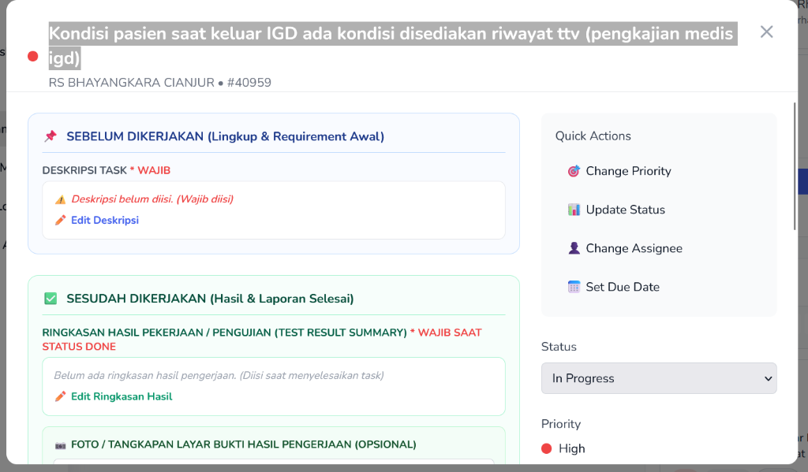
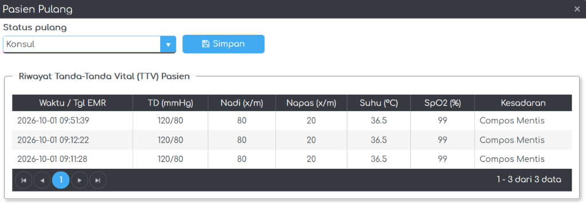

# Studi Kasus 1: SIMRS RS Bhayangkara Cianjur (`#40959`)

* **Nomor Tiket MARK**: `#40959`
* **Judul Tugas**: *Kondisi pasien saat keluar IGD ada kondisi disediakan riwayat TTV (Pengkajian Medis IGD)*
* **Commit Hash**: `41a6e0ff6755ea4bafcd2d1f344585a0711aeac2`

---

## 1. Tangkapan Layar Bukti Pengerjaan

### A. Tiket Penugasan pada Sistem Manajemen Proyek (MARK)


### B. Hasil Akhir Implementasi Antarmuka (Pop-up Pasien Pulang & Tabel Riwayat TTV)


---

## 2. Deskripsi Kebutuhan
Pada modul **Daftar Antrian Suster Rawat Jalan / IGD**, ketika petugas medis memilih aksi **Pasien Pulang**, sistem perlu menampilkan tabel **Riwayat Tanda-Tanda Vital (TTV)** milik pasien tersebut selama masa perawatan, sehingga petugas dapat memverifikasi kondisi klinis terakhir pasien (Tekanan Darah, Nadi, Pernapasan, Suhu, SpO2, dan Kesadaran).

---

## 3. Daftar File dalam Folder Ini
1. [`DaftarAntrianSusterRajal.html`](./DaftarAntrianSusterRajal.html) — File *view* HTML AngularJS (Perubahan pada baris `1063–1285`).
2. [`DaftarAntrianSusterRajalCtrl.js`](./DaftarAntrianSusterRajalCtrl.js) — File *controller* AngularJS (Perubahan pada baris `31–101` dan `2330–2333`).
3. [`commit-41a6e0ff.diff`](./commit-41a6e0ff.diff) — File *patch/diff* asli dari Git yang menunjukkan baris kode yang ditambahkan dan diubah.

---

## 4. Cuplikan Implementasi Kode Utama

### A. Konfigurasi Kendo UI Grid (`DaftarAntrianSusterRajalCtrl.js`)
```javascript
$scope.ttvGridOptions = {
    pageable: {
        pageSize: 5,
        messages: {
            display: "{0} - {1} dari {2} data",
            empty: "Tidak ada data TTV"
        }
    },
    scrollable: false,
    columns: [
        { field: "tgl", title: "Waktu / Tgl EMR", width: "160px" },
        { field: "tekanandarah", title: "TD (mmHg)", width: "100px", attributes: { style: "text-align: center" } },
        { field: "nadi", title: "Nadi (x/m)", width: "90px", attributes: { style: "text-align: center" } },
        { field: "pernapasan", title: "Napas (x/m)", width: "95px", attributes: { style: "text-align: center" } },
        { field: "suhu", title: "Suhu (°C)", width: "85px", attributes: { style: "text-align: center" } },
        { field: "spo2", title: "SpO2 (%)", width: "85px", attributes: { style: "text-align: center" } },
        { field: "kesadaran", title: "Kesadaran", width: "130px" }
    ]
};
```

### B. Pengambilan & Pengelompokan Data REST API (`getRiwayatTtvPulang`)
```javascript
function getRiwayatTtvPulang(noRegistrasi) {
    $scope.sourceTtv = new kendo.data.DataSource({ data: [] });
    if (!noRegistrasi) return;

    medifirstService.get('emr/get-vital-sign-2?noRegistrasi=' + noRegistrasi).then(function (res) {
        var dataArray = [];
        if (res && res.data) {
            dataArray = Array.isArray(res.data) ? res.data : (res.data.data ? res.data.data : []);
        }

        if (dataArray && dataArray.length > 0) {
            var grouped = {};
            for (var i = 0; i < dataArray.length; i++) {
                var item = dataArray[i];
                var waktu = item.tgl ? item.tgl : '-';
                if (!grouped[waktu]) {
                    grouped[waktu] = {
                        tgl: waktu, tekanandarah: '-', nadi: '-',
                        pernapasan: '-', suhu: '-', spo2: '-', kesadaran: '-'
                    };
                }
                if (item.tekanandarah) grouped[waktu].tekanandarah = item.tekanandarah;
                if (item.nadi) grouped[waktu].nadi = item.nadi;
                if (item.pernapasan) grouped[waktu].pernapasan = item.pernapasan;
                if (item.suhu) grouped[waktu].suhu = item.suhu;
                if (item.spo2) grouped[waktu].spo2 = item.spo2;
                if (item.kesadaran) {
                    grouped[waktu].kesadaran = item.kesadaran.indexOf('~') !== -1
                        ? item.kesadaran.split('~')[1]
                        : item.kesadaran;
                }
            }

            var listData = [];
            for (var key in grouped) {
                listData.push(grouped[key]);
            }

            $scope.sourceTtv = new kendo.data.DataSource({
                data: listData,
                pageSize: 5
            });
        }
    }, function (error) {
        console.error('Gagal memuat data TTV:', error);
    });
}
```
