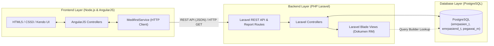
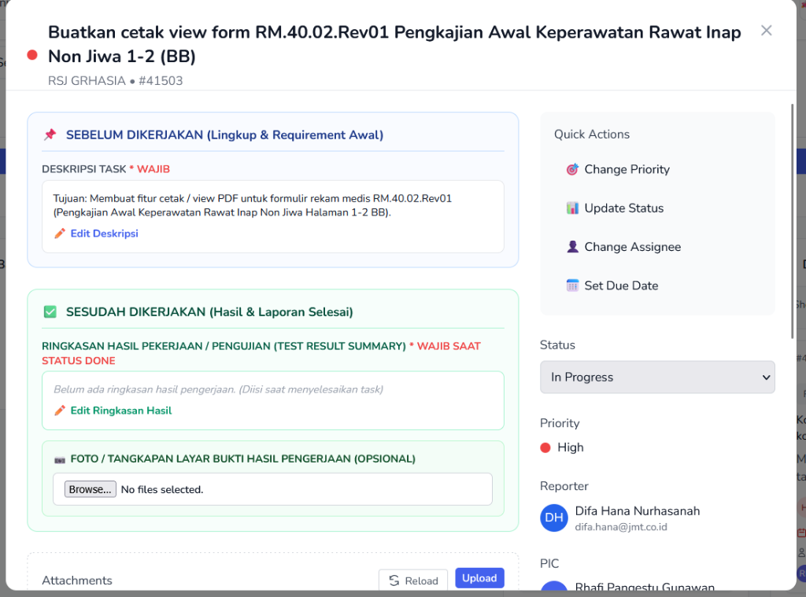
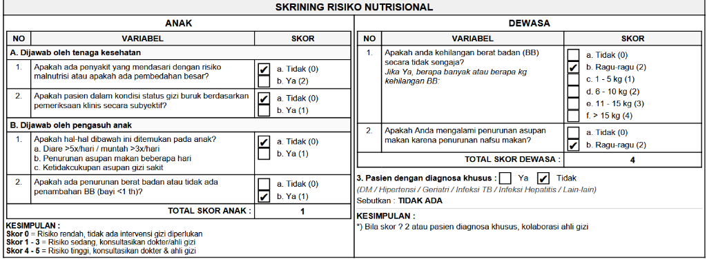
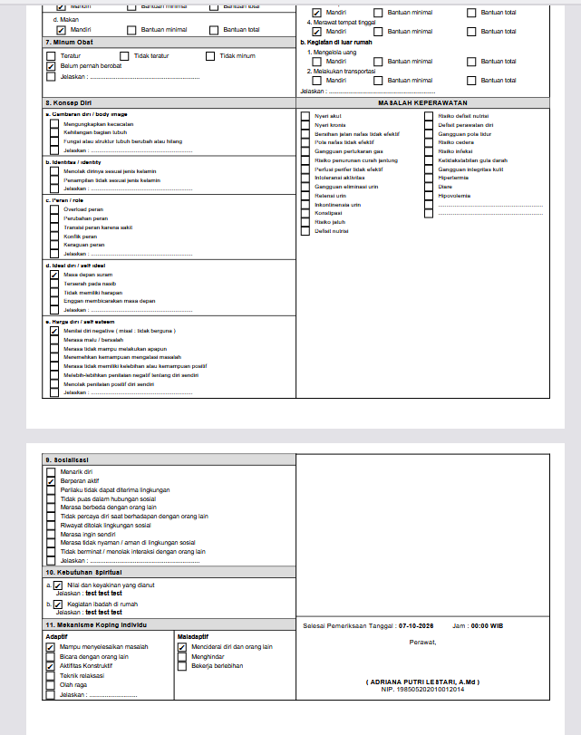
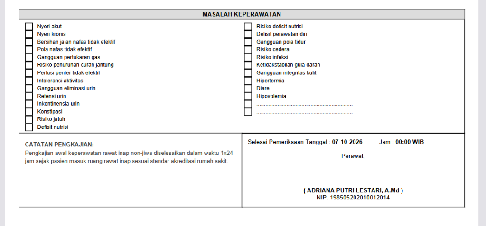

# Portofolio Uji Kompetensi BNSP — Pengembangan Aplikasi SIMRS

Repositori ini merupakan dokumentasi portofolio bukti kerja nyata (*Real-World Industry Portfolio*) dalam pengembangan dan pemeliharaan **Sistem Informasi Manajemen Rumah Sakit (SIMRS / Medifirst2000)** selama masa magang industri.

> [!IMPORTANT]
> **🔒 Pernyataan Kerahasiaan & Keamanan Informasi (NDA Disclaimer)**  
> Demi mematuhi Perjanjian Kerahasiaan Perusahaan (*Non-Disclosure Agreement*), menjaga Hak Kekayaan Intelektual (**PT. Jasamedika Saranatama**), serta melindungi keamanan infrastruktur rumah sakit mitra, repositori publik ini **hanya memuat modul spesifik, controller, template pelaporan, tangkapan layar hasil pengujian, dan bukti riwayat Git Diff (`commit.diff`)** yang dikerjakan secara langsung oleh kandidat, tanpa menyertakan *core engine* maupun kredensial sensitif perusahaan.

---

## 📂 Struktur Repositori Portofolio

```text
portofolio-bnsp-simrs/
├── README.md                                              # Dokumentasi Utama & Arsitektur Sistem
├── 01-rs-bhayangkara-cianjur-40959/                       # Studi Kasus 1: Modul IGD & Rawat Jalan
│   ├── README.md                                          # Dokumentasi Teknis Studi Kasus 1
│   ├── DaftarAntrianSusterRajal.html                      # View Modal Pop-up & Kendo UI Grid
│   ├── DaftarAntrianSusterRajalCtrl.js                    # Controller AngularJS & Integrasi REST API
│   ├── commit-41a6e0ff.diff                               # Bukti Otentik Git Commit Diff (#40959)
│   └── screenshots/                                       # Bukti Tangkapan Layar Tiket & UI
└── 02-rsj-grhasia-41503/                                  # Studi Kasus 2: Modul Rekam Medis Elektronik (EMR)
    ├── README.md                                          # Dokumentasi Teknis Studi Kasus 2
    ├── pengkajian-awal-keperawatan-ri-non-jiwa.blade.php  # Template Cetak RM.40.02.Rev01 (1.135 Baris)
    ├── PengkajianAwalKeperawatanRINonJiwaCtrl.js          # Controller Integrasi Cetak EMR
    ├── numericPainRatingScale_HD.png                      # Aset Visual Skala Nyeri Klinis
    ├── commit-3f2b16325.diff                               # Bukti Otentik Git Commit Diff (#41503)
    └── screenshots/                                       # Bukti Tangkapan Layar Tiket & Cetakan RM
```

---

## 🏗️ Arsitektur Sistem & Tech Stack

Aplikasi SIMRS yang dikembangkan mengadopsi arsitektur *Decoupled Web Application* (Frontend dan Backend terpisah):



| Komponen | Teknologi yang Digunakan |
| :--- | :--- |
| **Frontend Framework** | AngularJS 1.x, Kendo UI, HTML5, CSS3 (Flexbox & Print Media Query) |
| **Frontend Runtime** | Node.js & Express |
| **Backend Framework** | PHP 7.4, Laravel (REST API, Query Builder, Blade Templating Engine) |
| **Database** | PostgreSQL (Skema Relasional & *Entity-Attribute-Value* untuk EMR) |
| **Version Control & Manajemen Tugas** | Git (GitLab Enterprise) & MARK Task Management |

---

## 🎯 Pemetaan Kompetensi (Standar SKKNI / BNSP)

| Area Kompetensi | Implementasi Nyata pada Proyek |
| :--- | :--- |
| **Implementasi User Interface (UI)** | Pembuatan komponen tabel interaktif **Kendo UI Grid** dengan *pagination*, penataan tata letak *Pop-up Modal* menggunakan CSS Flexbox, serta pembuatan dokumen cetak medis presisi tinggi ukuran F4 (210mm x 330mm). |
| **Pemrograman Terstruktur & Modular** | Pembuatan fungsi *helper* PHP menggunakan *variadic parameters* (`getVal`, `isChecked`, `renderCB`) untuk menghindari duplikasi kode pada ratusan *field* Rekam Medis Elektronik (EMR). |
| **Konsumsi REST API & Akses Basis Data** | Pemanggilan *endpoint* REST API `emr/get-vital-sign-2` secara *asynchronous* menggunakan *Promise* (`.then()`) di AngularJS, serta query relasional ke tabel master `pegawai_m` di PostgreSQL menggunakan Laravel Query Builder. |
| **Manipulasi Struktur Data (Array/JSON/String)** | Pengelompokan (*grouping/pivoting*) array JSON riwayat tanda-tanda vital berdasarkan *timestamp* pemeriksaan, pemisahan string berformat `ID~Nilai` (`split` / `explode`), dan pembersihan gelar nama dengan *Regular Expression* (`preg_replace`). |
| **Penanganan Eksepsi & Debugging** | Validasi ketersediaan ID transaksi sebelum mencetak dokumen, *null-safety checking*, pembungkusan query database dengan blok `try-catch`, dan manajemen konflik *branching* Git (`stagging` vs `main`). |

---

## 📋 Ringkasan Studi Kasus & Bukti Hasil Kerja

### 1. [SIMRS RS Bhayangkara Cianjur — Tiket `#40959`](./01-rs-bhayangkara-cianjur-40959/)
* **Commit ID**: `41a6e0ff6755ea4bafcd2d1f344585a0711aeac2`
* **Deskripsi Tugas**: Menampilkan riwayat Tanda-Tanda Vital (TTV) pasien pada modal *pop-up* **"Pasien Pulang"** di modul IGD/Rawat Jalan agar tenaga medis dapat meninjau histori kondisi klinis pasien sebelum keluar IGD.
* **File Terkait**:
  * [`DaftarAntrianSusterRajal.html`](./01-rs-bhayangkara-cianjur-40959/DaftarAntrianSusterRajal.html)
  * [`DaftarAntrianSusterRajalCtrl.js`](./01-rs-bhayangkara-cianjur-40959/DaftarAntrianSusterRajalCtrl.js)
  * [`commit-41a6e0ff.diff`](./01-rs-bhayangkara-cianjur-40959/commit-41a6e0ff.diff)

#### 📸 Bukti Tiket & Hasil Implementasi UI (`#40959`)
| Tiket Penugasan MARK `#40959` | Hasil Akhir UI Pop-up & Tabel Kendo Grid Riwayat TTV |
| :---: | :---: |
|  |  |

---

### 2. [SIMRS RS Jiwa Grhasia Yogyakarta — Tiket `#41503`](./02-rsj-grhasia-41503/)
* **Commit ID**: `3f2b16325bb96d943e76a69f38aae7c27a7a42e5`
* **Deskripsi Tugas**: Membangun fitur dan *template* cetak tampilan formulir **RM.40.02.Rev01 — Pengkajian Awal Keperawatan Rawat Inap Non Jiwa** sesuai standar akreditasi rumah sakit.
* **File Terkait**:
  * [`pengkajian-awal-keperawatan-ri-non-jiwa.blade.php`](./02-rsj-grhasia-41503/pengkajian-awal-keperawatan-ri-non-jiwa.blade.php)
  * [`PengkajianAwalKeperawatanRINonJiwaCtrl.js`](./02-rsj-grhasia-41503/PengkajianAwalKeperawatanRINonJiwaCtrl.js)
  * [`commit-3f2b16325.diff`](./02-rsj-grhasia-41503/commit-3f2b16325.diff)

#### 📸 Bukti Tiket & Hasil Cetakan Formulir RM.40.02.Rev01 (`#41503`)
| Tiket Penugasan MARK `#41503` | Hasil Cetak Bagian Skrining Risiko Nutrisional |
| :---: | :---: |
|  |  |

| Hasil Cetak Halaman Lanjutan (Psikososial & Koping) | Hasil Cetak Masalah Keperawatan & Tanda Tangan + NIP Perawat |
| :---: | :---: |
|  |  |
